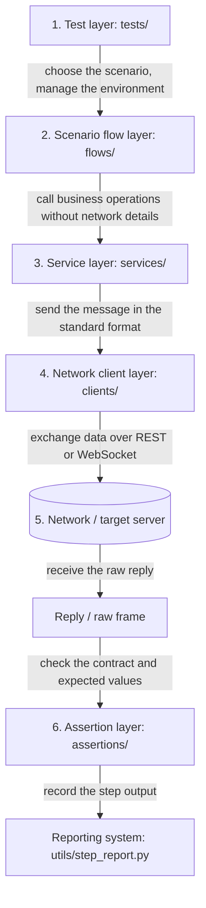

# 🏛️ Architecture & Design Patterns

This section shows how the project is architected and which software design patterns keep the tests clean, readable, modular and scalable.

---

## 1. Layered Architecture Flow

One of the biggest mistakes in test-automation projects is a test that sends an HTTP request itself, parses the reply itself and runs several business steps at once. This project is designed as **6 separate layers**:



---

## 2. The Layers One by One

### Layer 1: Tests (`tests/`)
- **Role:** only calls the scenario and checks the final result.
- **Trait:** no network logic or URL is written in a test. Tests are short, readable and clear (usually under 10 to 15 lines).
- **Example:** `tests/success/test_base_success.py`

### Layer 2: Flows (`flows/`)
- **Role:** orchestrator of several consecutive business steps.
- **Example:**
  1. first the admin login
  2. then the device IP registration
  3. then the socket connection
  4. then the device authentication
  5. then the barcode registration and the reply
- **Trait:** records every step as a Step in the reporting system.

### Layer 3: Services (`services/`)
- **Role:** abstraction of the device's business concepts.
- **Example:** `DeviceService` has methods such as `auth()`, `register_inbound()`, `assign_destination()`, `close_bag()`.
- **Trait:** protocol details (the structure of the JSON format, or which SignalR method a message goes to) are encapsulated in the service.

### Layer 4: Clients (`clients/`)
- **Role:** pure physical and protocol communication with the network.
- **Clients:**
  - `RestClient`: manages HTTP sessions and headers.
  - `DeviceWebSocketClient`: manages the socket connection, the SignalR handshake, ping/pong and the trailing `0x1E` bytes.

### Layer 5: Assertions (`assertions/`)
- **Role:** checks the rules and contracts of replies (Contract Assertions).
- **Example:** `assert_success_response(response, "Auth")` or `assert_valid_bag_close_response(response)`.
- **Benefit:** instead of scattered `assert response["status"] == 200`, tests use uniform, readable functions with clear error messages.

### Layer 6: Reporting and tools (`utils/`)
- **Role:** structured logging, timing of every step, masking of security data (such as tokens and passwords) and random test-data generation.

---

## 3. Design Patterns Used

### 1. Facade pattern
- **Where is it used?** In the `flows` and `services` layers.
- **Why?** So tests do not have to deal with internals such as opening a socket, creating an InvocationId, building the protocol Envelope and validating the handshake. The service offers a clean, simple interface (Facade).

### 2. Adapter / Wrapper pattern
- **Where is it used?** In `clients/rest_client.py` and `clients/signalr_client.py`.
- **Why?** Raw libraries such as `requests` or `websocket-client` are not enough for test scenarios on their own; we need to keep every request and reply in memory (`last_exchange`) so that on failure we can show exactly which message was sent and which reply came back.

### 3. Context Manager pattern (`__enter__` and `__exit__`)
- **Where is it used?** In `RestClient` and `DeviceWebSocketClient`.
- **Why?** So connections and sockets are opened automatically and closed cleanly at the end of the test, even on an error or Exception (`resource cleanup`):
```python
with DeviceWebSocketClient(ws_url) as ws:
    # socket work
# here the connection is closed automatically
```

### 4. Step Runner / Pipeline pattern
- **Where is it used?** In the `run_step` function in `utils/step_report.py`.
- **Why?** So that every step is encapsulated as an independent action and timed; on success it is recorded as `PASSED`, on failure as `FAILED`, and the remaining steps are cancelled at once and marked `NOT_EXECUTED`.

### 5. Immutability & Safe Defaults with Dataclasses
- **Where is it used?** In the `Settings` class in `config/settings.py`, with the `@dataclass(frozen=True)` decorator.
- **Why?** Application settings must not be changed accidentally by any code while tests run. Also, all settings have valid, safe defaults (Safe Defaults).
