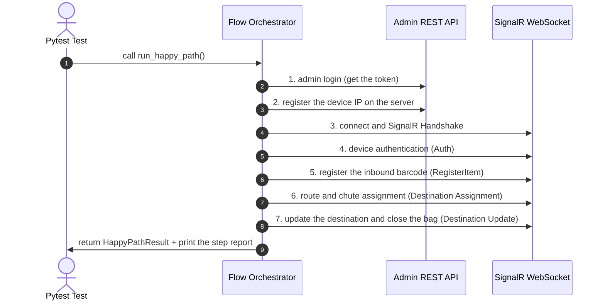

# 🔄 Flows & Orchestration

The **Flows** layer is the heart of coordinating Integration and End-to-End tests. In this section we learn how complex scenarios are organized with different step orders.

---

## 1. What is the difference between a Service and a Flow?

| Aspect | Service (`services/`) | Flow (`flows/`) |
|---|---|---|
| **Scope** | Performs **a single operation** | Coordinates **a sequence of operations** |
| **Dependency** | Only connected to a Client | May combine several Clients and Services |
| **Reporting** | Knows nothing about `step_report` | Records and manages every step in the `ExecutionReport` |
| **Example** | The `device.register_inbound(barcode)` method | The `run_happy_path()` function, which runs login, socket, register and destination assignment one after another |

---

## 2. A Complete Positive Scenario (Happy Path Flow)

In `flows/device_lifecycle/device_auth_flow.py`, the `run_happy_path` function implements the standard flow of the whole system:



### Key traits of the Flow design:
1. **Step Registration up front:**
   At the start of every Flow, all the steps that will run are registered in the report:
   ```python
   report = ExecutionReport("Project base success flow")
   report.register(
       "1. [BASE] Admin Login - POST /api/admin/login",
       "2. [BASE] Update Device IP - PUT /api/devices/{deviceId}/ip",
       "3. [BASE] SignalR Connect/Handshake - WebSocket /hubs/device",
       ...
   )
   ```
2. **Using `run_step` for control and isolation:**
   Every step is called inside `run_step`, so if step 2 fails the report stops, the later steps are marked `NOT_EXECUTED`, and the main error is saved with full detail.
3. **Returning a structured result object (`HappyPathResult`):**
   An output dataclass with the important replies, the admin token and the report object is returned, so the test that called this Flow can run extra assertions on the data.

---

## 3. Negative Scenarios

Negative tests check the system's behavior with invalid input, lost connections, business errors and incomplete authentication.

In the `flows/` folder, negative scenarios are designed for the different areas:
- **`flows/device_lifecycle/device_lifecycle_negative_flow.py`:** trying to send a message before login or with an invalid token.
- **`flows/destination/destination_assignment_negative_flow.py`:** sending an unregistered barcode or an invalid destination code.
- **`flows/destination/destination_update_negative_flow.py`:** trying to change the destination after the bag is closed (`TC-05: Reject update after container close`).
- **`flows/bag/export_before_container_negative_flow.py`:** trying to export or send before the physical container is closed.

### The negative scenario test pattern:
In negative scenarios we expect the system to return an error, so we check that:
1. Did the server return a suitable error? (`errorCode` or an understandable message)
2. Did the system avoid crashing and keep the database state healthy?
3. Was the socket connection kept alive, or did it answer the error safely?
